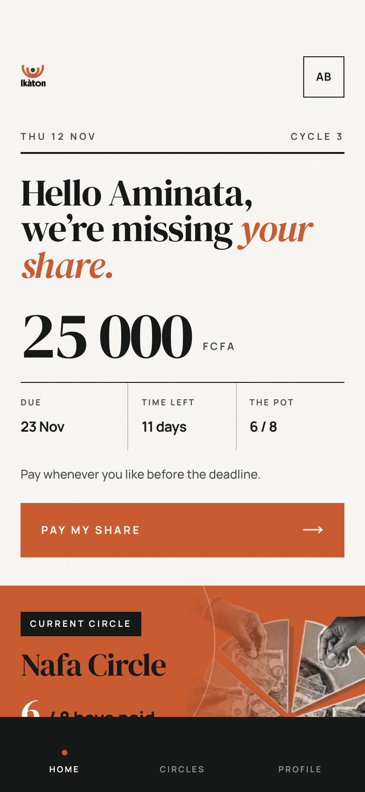
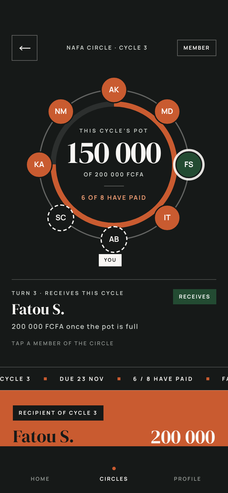
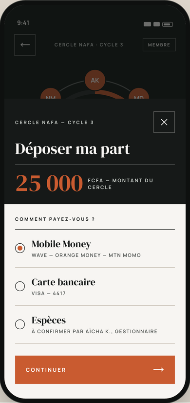
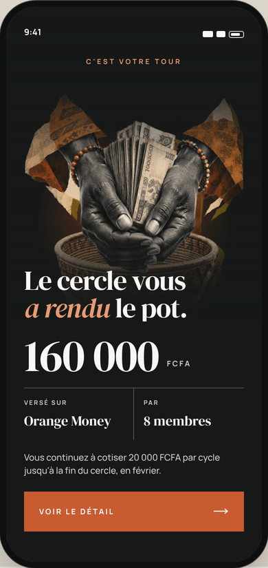
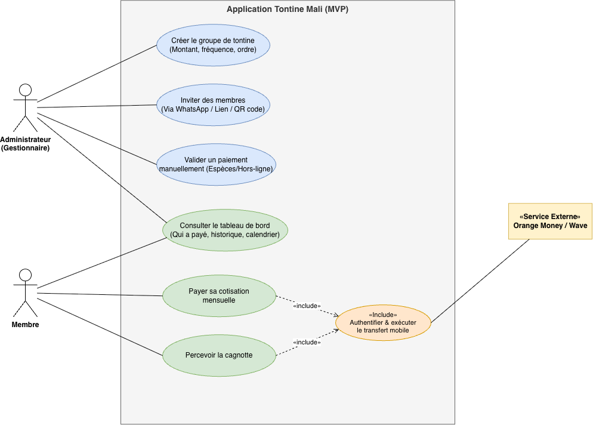
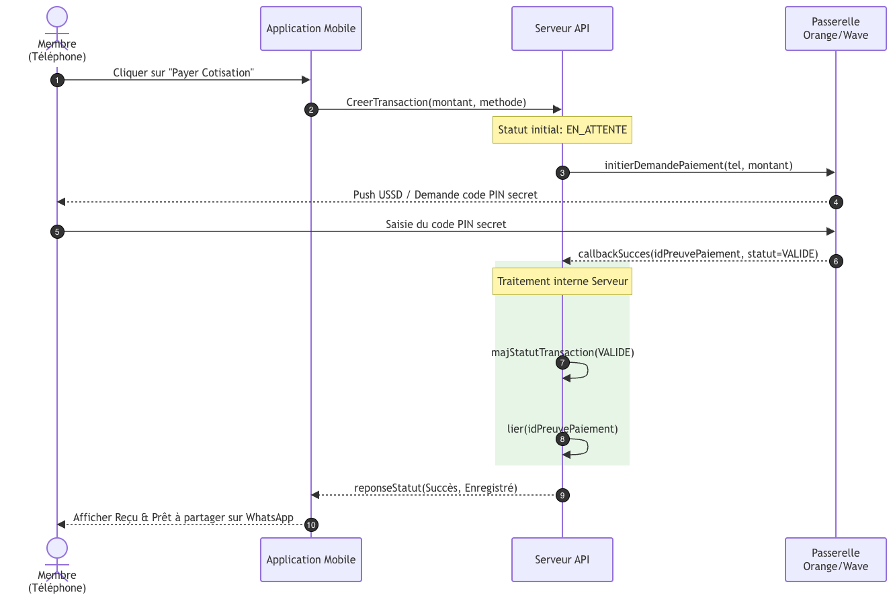
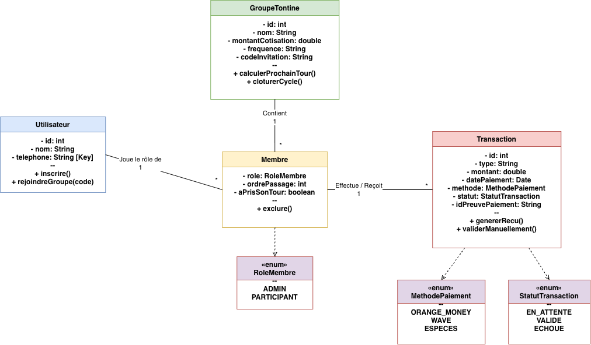

<div align="center">


### The tontine, kept straight.

A mobile-first web app for rotating savings circles (*tontines*) in Mali:
everyone pays in, everyone gets their turn, and every franc is counted exactly once.

[**Live demo**](https://YOUR-DEPLOYMENT-URL) · [Case study](https://YOUR-CASE-STUDY-URL) · [Engineering notes](docs/ENGINEERING_NOTES.md)

[](https://github.com/admaia/Ikaton-app/actions/workflows/ci.yml)

</div>

---

## The problem

A tontine is a savings circle: a group of people pays the same amount every week or month, and each cycle one member receives the whole pot. It is one of the most common ways to save in Mali and across West Africa.

Today, most circles are run from a paper notebook or a WhatsApp group. That works until it doesn't: a payment is forgotten, someone claims they paid twice, the order of turns is disputed, and the organiser carries all the trust.

**Ikàton** keeps the notebook for the group: who paid, who is next, and a record nobody can quietly edit.

> The interface is in French because Ikàton is built for tontine groups in Mali.

## Try it in one click

No phone number needed. On the live demo, tap **« Essayer la démo »**:

- You land in two ready-made circles: a **member** in one (a share to pay) and the **organiser** in the other (a cash deposit to validate). Roles belong to a circle, not to a person.
- When you pay, you play the mobile-money operator. You choose what happens and see exactly how the server reacts:

| You choose | What the server does |
|---|---|
| Approve | Verifies with the operator, counts the share once |
| Refuse | Marks the payment failed, nothing is charged |
| Do nothing | Expires the payment after 2 minutes, nothing is counted |
| Confirm twice | Counts the first, ignores the duplicate |
| Fake confirmation | Rejects the forged and replayed messages |

On a computer, the app runs live inside a phone frame next to the project description. On a phone, it is installable as an app (PWA).

## Screenshots

Screens from the design prototype. Some of them (payout, for instance) show flows that are designed but not built yet; see the roadmap.

| Home | Circle | Payment | Payout |
|---|---|---|---|
|  |  |  |  |

## Design first

The product was designed before any code: use cases, the payment flow, and the data model.

| Use cases | Payment sequence | Data model |
|---|---|---|
|  |  |  |

## Payment safety

Money is where a tontine app earns or loses trust, so the payment flow answers three questions.

**What if the confirmation never arrives?**
Every payment has a deadline. A scheduled job asks the operator one last time, then marks the payment expired. The screen never shows "pending" past the deadline, even if the job is late. If the money really did move after the deadline, a verified late confirmation can still be counted.

**What if it arrives twice?**
Four independent locks: every webhook event is stored once, payment status changes use compare-and-set, the database allows only one counted share per member per cycle, and confirmation runs in a serializable transaction. On the client, an idempotency key means a double tap never starts two payments.

**What if someone sends a fake one?**
Wave webhooks are checked with an HMAC signature (constant-time comparison, 5-minute replay window). Orange Money callbacks are checked against a token stored only as a hash. Even a valid webhook only *triggers* a check: the amount and status always come from a server-to-server call to the operator. A mismatch is parked for review, never counted.

More detail in [docs/ENGINEERING_NOTES.md](docs/ENGINEERING_NOTES.md).

## Stack

**Front end:** Next.js 15 (App Router), React 19, TypeScript, Tailwind CSS 4, Motion, GSAP, Lenis
**Back end:** Next.js route handlers, Prisma, PostgreSQL and Auth on Supabase, Zod
**Payments:** Wave Checkout, Orange Money WebPay, a sandbox operator for the demo
**Quality:** Vitest, ESLint, TypeScript strict mode, Trivy, SonarCloud, GitHub Actions

```
src/app            screens (onboarding, auth, home, circle, payment) and API routes
src/lib/payments   state machine, signature checks, idempotent creation, settle-once, reconciliation
src/lib            auth, data access, draw (commit–reveal), money formatting, validation
tests              state machine, signatures, settle-once rules, webhook route
```

## Quality

- **Tests** cover the logic that moves money: the payment state machine, signature and token checks, the settle-once rules (duplicates, amount mismatch, share already paid, late confirmation) and the Wave webhook route (forged, unsigned, replayed and redelivered events).
- **CI** runs typecheck, lint and tests with coverage on every push, then a **SonarCloud** analysis.
- **Trivy** scans dependencies, committed secrets and configuration on every push.
- **Input validation:** every external input (request bodies, URL parameters, webhook payloads) is validated before it reaches the database.

## Run it locally

```bash
cp .env.example .env.local     # fill in Supabase, provider keys and a random SANDBOX_WEBHOOK_SECRET
npm install
npm run db:push                # schema + database constraints (prisma/sql/constraints.sql)
SEED_ME_ID=<your Supabase user id> npm run db:seed
npm run dev
```

```bash
npm test             # unit and route tests
npm run typecheck    # TypeScript
npm run lint         # ESLint
```

For the one-click demo, enable **Anonymous sign-ins** in Supabase (Auth → Providers) and set `DEMO_MODE=true` and `NEXT_PUBLIC_DEMO_MODE=true`.

## How I built this

I designed Ikàton and built it with AI assistance.

**My part:** the product idea and scope, the use cases, payment sequence and data model (the diagrams above), the visual direction, the payment-safety requirements (what happens when a confirmation is late, duplicated or forged), and the review of every change.

**AI-assisted:** large parts of the implementation were generated with AI coding tools, working from those diagrams, the design direction and a set of engineering rules I wrote (architecture, security, testing).

**How I checked it:** I reviewed the code against those rules, added tests on the logic that moves money, and run TypeScript, ESLint, Trivy and SonarCloud on every push. The demo operator exists so anyone can verify the payment guarantees themselves instead of taking my word for it.

## Roadmap

Not built yet: creating a circle, joining by invitation code, the full ledger, payouts, leaving a circle, reminders, Moov Money and card payments. Planned for v2: end-to-end tests with Playwright, rate limiting on public endpoints, and a full Content-Security-Policy.

## Author

**Adama Aïssa Maïga** · Front-end developer & design engineer · Bamako, Mali
[GitHub](https://github.com/admaia) · [LinkedIn](https://linkedin.com/in/YOUR-LINKEDIN)

## License

[MIT](LICENSE)
